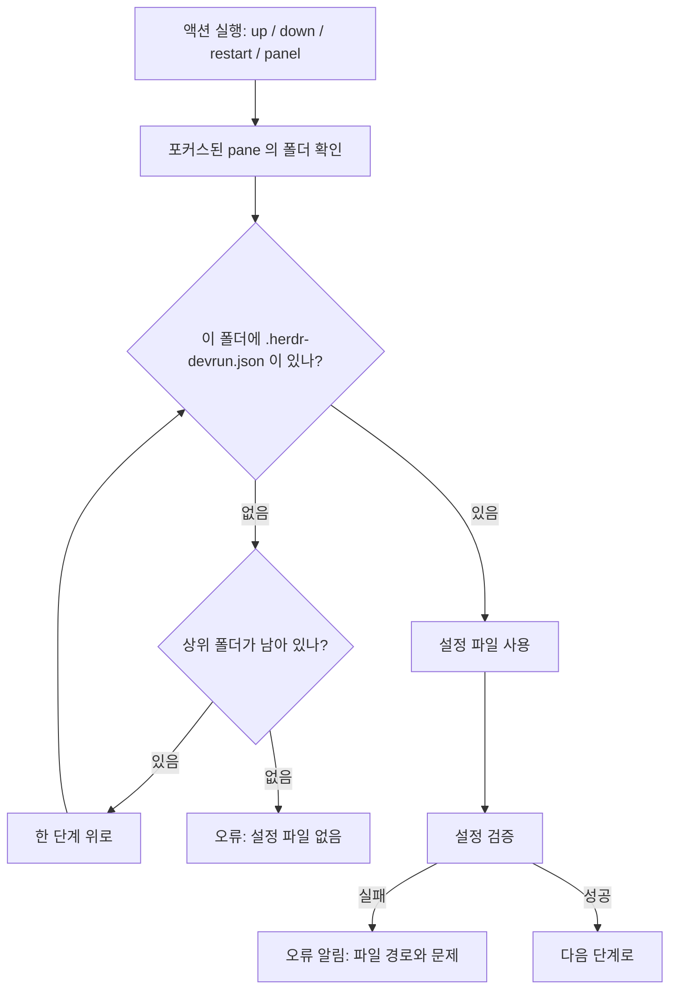
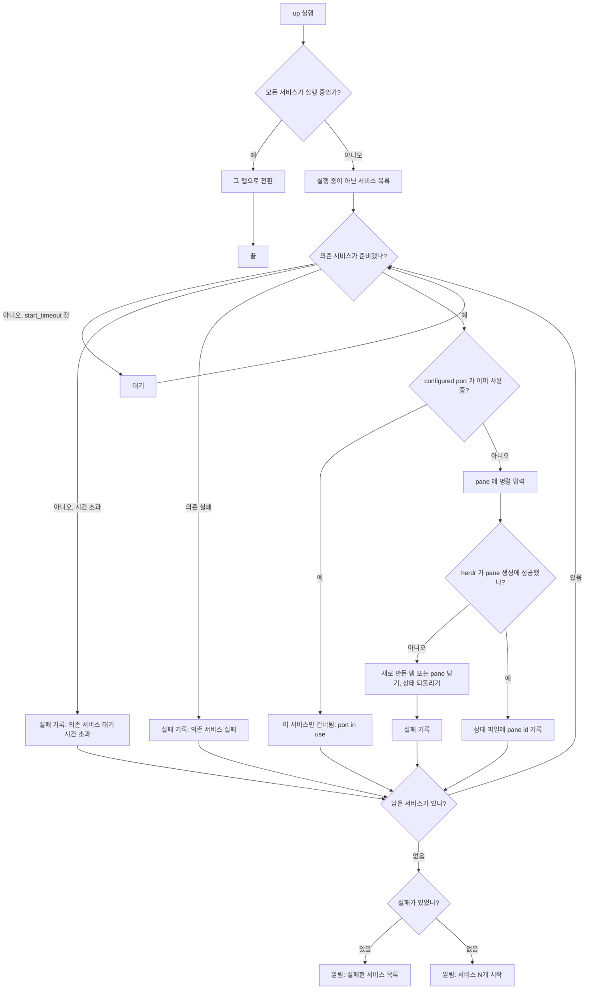
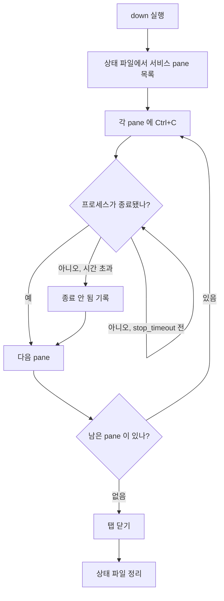
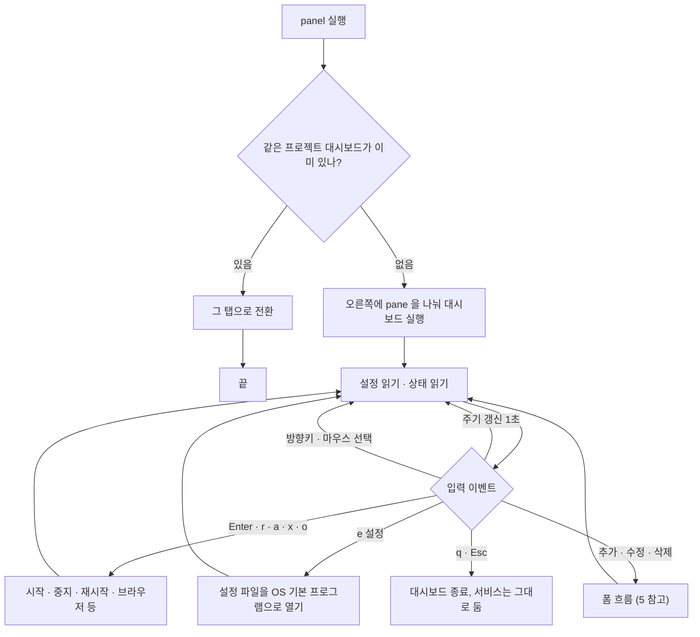
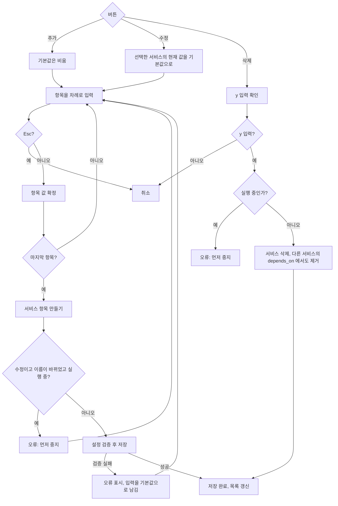
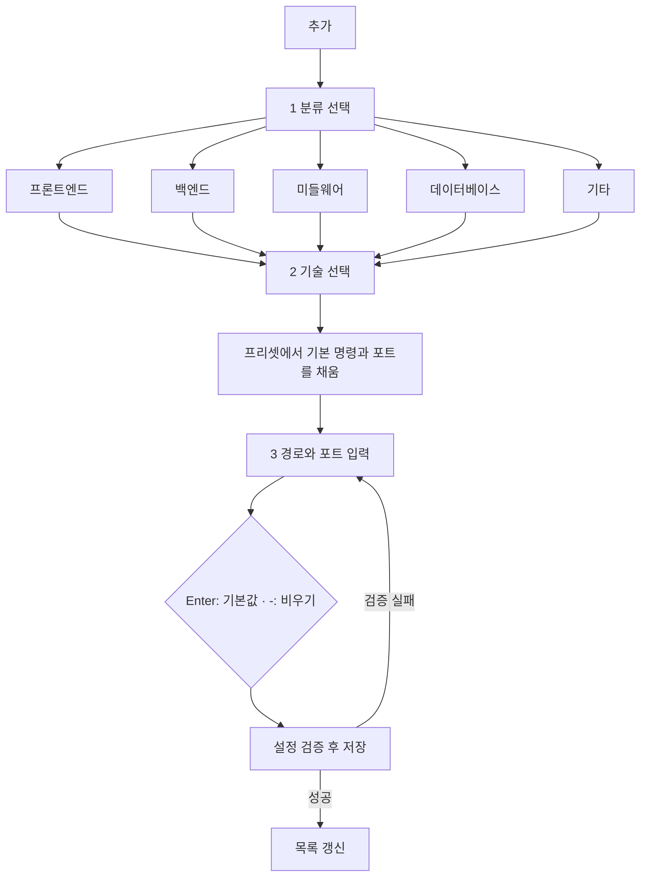

# 흐름도

herdr-devrun 의 주요 동작을 흐름도로 정리합니다. 그림은 Mermaid 로 적었으므로 GitHub 나 Mermaid 를 지원하는 편집기에서 보입니다.

- 세부 설정 항목은 [usage.md](usage.md) 를 봅니다.
- 상태 저장과 모듈 구조는 [architecture.md](architecture.md) 를 봅니다.

## 1. 설정 파일 찾기

액션을 실행한 pane 의 폴더에서 위로 올라가며 `.herdr-devrun.json` 을 찾습니다. 못 찾으면 오류입니다.

## 2. 서비스 시작 (`up` / `run`)

실행 중인 서비스는 건너뛰고, 나머지를 `depends_on` 순서대로 시작합니다.

## 3. 서비스 중지 (`down`)

각 pane 에 Ctrl+C 를 보내고, 프로세스가 끝날 때까지 `stop_timeout` 만큼 기다린 뒤 탭을 닫습니다.

`restart` 는 `down` 을 한 뒤 `up` 을 실행합니다.

## 4. 대시보드 (`panel`)

대시보드는 1초마다 상태를 다시 읽고, 설정 파일이 바뀌면 다시 불러옵니다.

## 5. 서비스 추가 · 수정 · 삭제 폼

추가·수정은 항목을 차례로 묻습니다. Enter 는 칸의 기본값을 받고, `-` 는 값을 비웁니다. 저장 전에 설정 전체를 검증하므로, 잘못되면 파일은 그대로 두고 입력을 기본값으로 남겨 처음부터 다시 묻습니다.

**현재 구현** (이름 → 폴더 → 명령 → 포트 → URL → 의존 서비스)

**계획 중** (개발 중인 3단계 선택 흐름: 분류 → 기술 → 경로와 포트)

프리셋은 언어와 기술별 기본 포트와 실행 명령을 담습니다. React(Vite) 처럼 포트를 고정하지 않는 기술은 기본 포트를 비워 둡니다.
