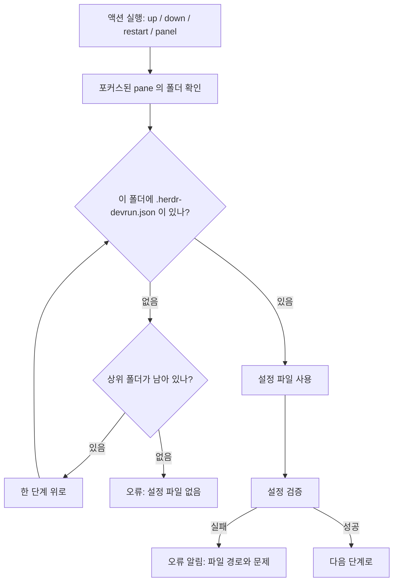
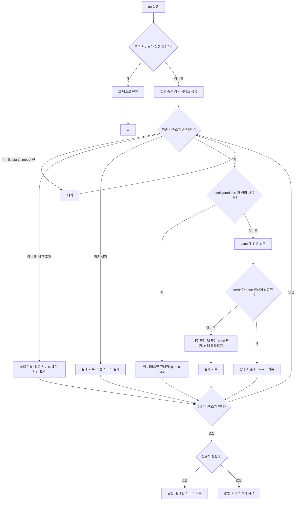
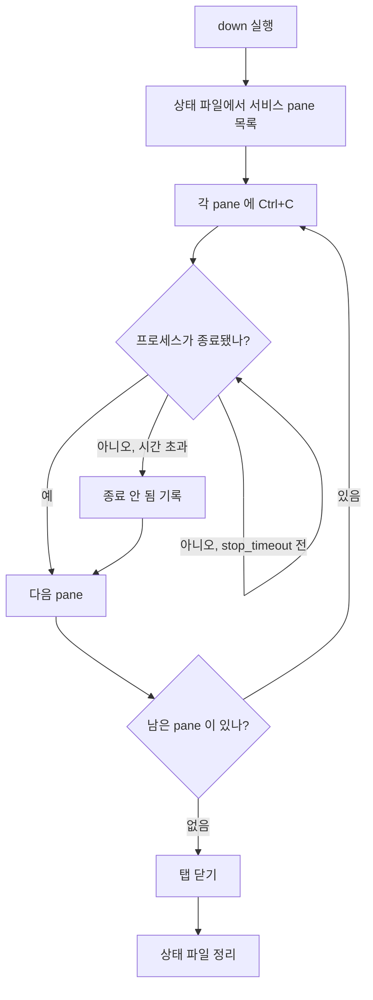
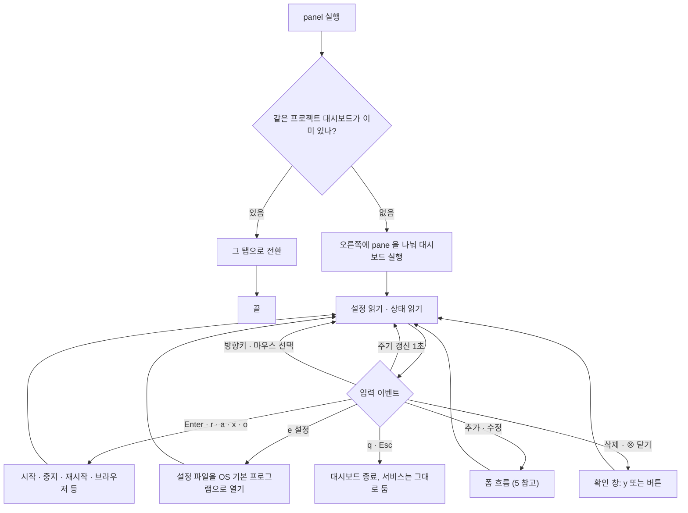
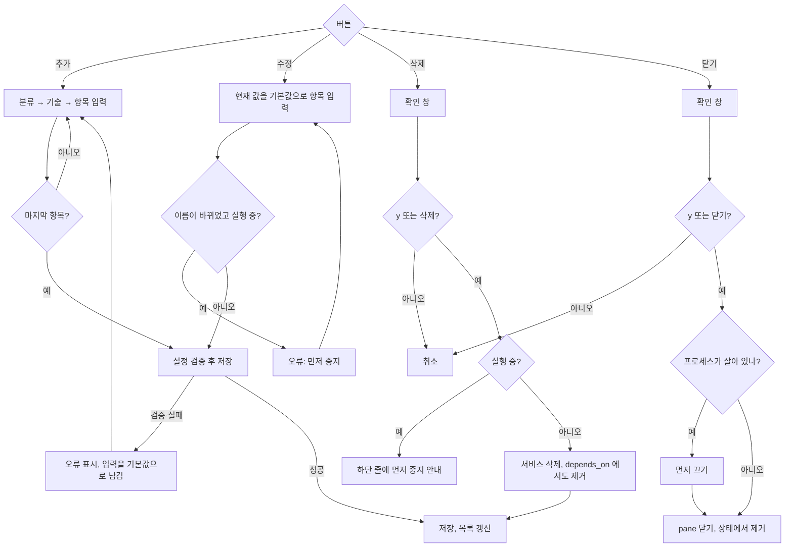

# 흐름도

herdr-devrun 의 주요 동작을 흐름도로 정리합니다. 그림은 Mermaid 로 적었으므로 GitHub 나 Mermaid 를 지원하는 편집기에서 보입니다.

- 세부 설정 항목은 [usage.md](usage.md) 를 봅니다.
- 상태 저장과 모듈 구조는 [architecture.md](architecture.md) 를 봅니다.

## 1. 설정 파일 찾기

액션을 실행한 pane 의 폴더에서 위로 올라가며 `.herdr-devrun.json` 을 찾습니다. 못 찾으면 오류입니다.

## 2. 서비스 시작 (`up` / `run`)

실행 중인 서비스는 건너뛰고, 나머지를 `depends_on` 순서대로 시작합니다.

## 3. 서비스 중지 (`down`)

각 pane 에 Ctrl+C 를 보내고, 프로세스가 끝날 때까지 `stop_timeout` 만큼 기다린 뒤 탭을 닫습니다. 기다리는 동안 Y/N 질문이 나오면 `Y`로 답합니다.

`restart` 는 `down` 을 한 뒤 `up` 을 실행합니다.

대시보드의 중지(`Enter`)와 전체 중지(`x`)는 `down` 과 다릅니다. 프로세스만 끄고 pane 을 '중지' 표시로 남기며, 제 시간에 끝나지 않은 pane 만 닫습니다. 탭과 컨트롤 박스는 그대로 둡니다. 다시 시작하면 같은 pane 에서 명령을 다시 입력합니다.

## 4. 대시보드 (`panel`)

대시보드는 1초마다 상태를 다시 읽고, 설정 파일이 바뀌면 다시 불러옵니다.

## 5. 서비스 추가 · 수정 · 삭제 · 닫기

- **추가**: 하단 줄의 `+ 추가`. 분류 → 기술 → 이름·폴더·명령·포트·URL·의존 순서로 묻고, 마지막에 설정 전체를 검증해 저장한다. 실패하면 파일은 그대로 두고 입력을 기본값으로 남겨 처음부터 다시 묻는다.
- **수정**: 행의 `✎ 수정`. 현재 값을 기본값으로 같은 칸을 묻는다. 실행 중인 서비스의 이름은 바꿀 수 없다.
- **삭제**: 행의 `✕ 삭제`. 확인 창에서 `y` 또는 **삭제**를 누르면 지운다. 실행 중이면 창을 띄우지 않고 하단 줄에 먼저 중지하라고 안내한다.
- **닫기**: 행의 `⊗`. 확인 창에서 `y` 또는 **닫기**를 누르면 그 서비스의 pane 을 닫는다. 실행 중이면 먼저 끈다. 탭과 컨트롤 박스는 남는다.

프리셋은 언어와 기술별 기본 포트와 실행 명령을 담습니다. React(Vite) 처럼 포트를 고정하지 않는 기술은 기본 포트를 비워 둡니다.
